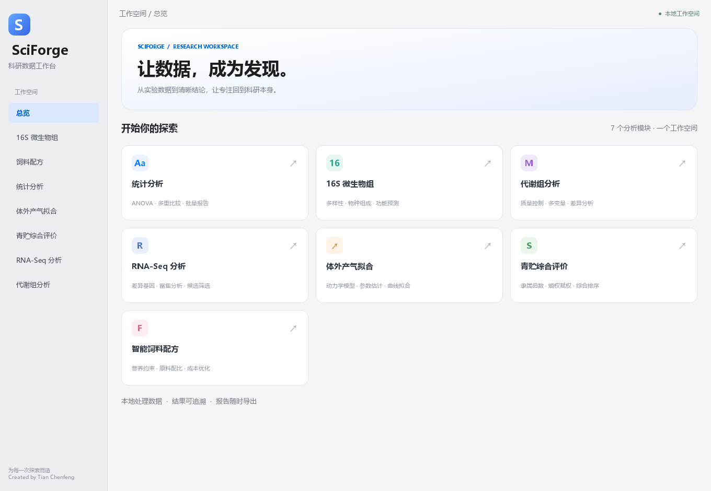

# SciForge

**科研数据工作台 · Integrated Research Analysis Platform**

Created by Tian Chenfeng

面向生命科学与农业科研的 Windows 桌面分析工具。将实验数据整理、统计检验、可视化和报告导出放在同一个工作空间。

## 下载运行

前往 [GitHub Releases](https://github.com/tianchenfeng/SciForge/releases)，下载最新 Windows x64 ZIP，完整解压后双击 `SciForge/SciForge.exe`。无需安装 Python；请保留同目录的 `_internal` 文件夹。



## 分析模块

| 模块 | 功能 |
| --- | --- |
| 统计分析 | 单/双因素 ANOVA、Tukey 多重比较、显著性字母、多指标批量 Excel/Word 报告 |
| 16S 微生物组 | 已导出数据的 QC、多样性、群落组成、功能预测结果、相关性及主要菌群表 |
| 代谢组 | QC、显式预处理、PCA、嵌套交叉验证 PLS-DA、单/双因素、简单效应、富集与报告 |
| RNA-Seq | 差异基因筛选、候选排序、注释整合、GO/KEGG 结果整理与图表 |
| 体外产气 | 指数/带 Lag 模型、批量曲线拟合、参数估计和结果导出 |
| 青贮综合评价 | 隶属函数、熵权赋权、综合得分与处理排序 |
| 饲料配方 | 最低成本优化、营养与粗料比例约束、营养回算 |

16S 输入为已有 feature-table、taxonomy、metadata 等文件；ASV 功能预测表须与 feature-table 对应。原始 FASTQ 的 QIIME2/PICRUSt2 环境需另行配置。

## 4.1 Desktop Edition

统一侧栏、模块卡片和浅灰白主题；长页面可滚动，首页、配方及代谢组按宽度调整布局。修复配方加减按钮与状态绑定，补全输入边界校验，并提供发行包自检。

详见 [发布说明](docs/RELEASE_4.1.md) 与 [验收记录](docs/VALIDATION_4.1.md)。已有统计计算算法保持原样。

## 从源码运行

```powershell
python -m pip install -r requirements.txt
python app.py
```

## 检验与构建

```powershell
python -m pip install pytest pyinstaller
python -m pytest tests modules/module_stats modules/module_metabolomics/tests -q
python build_release.py
```

构建结果位于 `release/SciForge-v4.1-desktop-windows-x64/SciForge`。程序支持诊断命令：

```powershell
.\SciForge.exe --self-test --output .\diagnostics
```

`test/`、`01_input/`、`02_output/` 和运行结果不进入版本控制。测试输出属于软件验证材料，不能作为实验结论。

## 科研使用

本项目面向科研与教学。分析前应确认研究设计、样本分组、尺度和方法适用性；正式发表的结果应独立复核。

如 SciForge 帮助了你的研究，可引用：

> Tian Chenfeng. SciForge: Integrated Research Analysis Platform.

For academic and research use.
